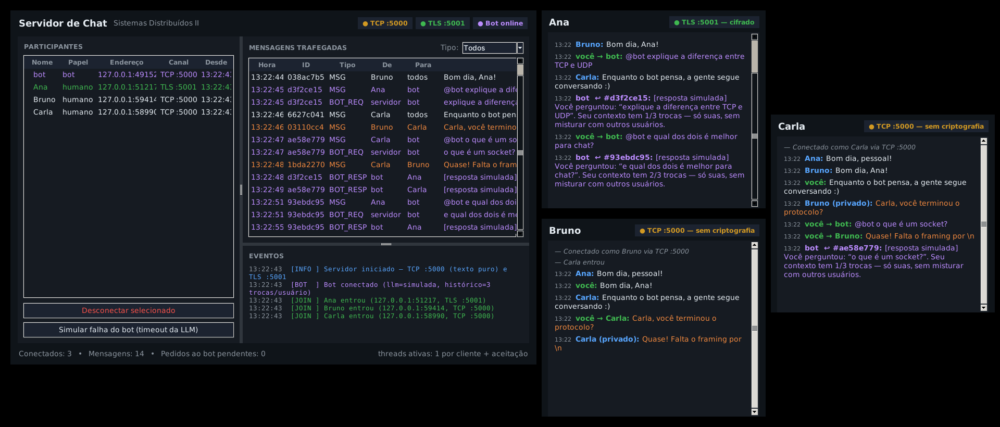

# ProjetoFinalSD2 — branch `teste`: protótipo das interfaces

Protótipo **apenas visual** das telas do chat distribuído (servidor + clientes humanos + bot)
do trabalho prático de Sistemas Distribuídos II. Serve para ver o layout e o comportamento
antes de implementar os sockets de verdade na branch principal.



## Como executar

Requer só Python 3.10+ com `tkinter` (já vem no instalador oficial do Windows).
No Linux, se faltar: `sudo apt install python3-tk`.

```bash
python executar_demo.py            # abre servidor + Ana, Bruno e Carla para você interagir
python executar_demo.py --roteiro  # roda uma conversa automática de exemplo
```

Nas janelas dos clientes:

- **Enter / Enviar** manda para a sala; clique em um nome da lista para mandar **privado**.
- Comece com **`@bot`** (ou clique no botão `@bot`) para perguntar ao bot. A resposta chega
  só para quem perguntou, com o mesmo `#id` da solicitação, e você pode continuar digitando
  enquanto espera.
- **Sair** gera o evento de desconexão no servidor.

Na janela do servidor:

- **Participantes** — nome, papel, endereço, canal (TCP :5000 ou TLS :5001) e horário de entrada.
- **Mensagens trafegadas** — todos os envelopes (`MSG`, `BOT_REQ`, `BOT_RESP`, `BOT_ERR`, `ERROR`) com filtro por tipo.
- **Eventos** — entradas, saídas, falhas.
- **Simular falha do bot** — as próximas perguntas recebem `BOT_ERR` (cenário de timeout da LLM exigido na demonstração).
- **Desconectar selecionado** — derruba um cliente e descarta os pedidos pendentes dele.

## O que é real e o que é simulado

| Parte | Neste protótipo | No projeto final |
|---|---|---|
| Telas (tkinter) | real | reaproveitadas |
| Envelope JSON (`v, type, id, from, to, ts, content`) | real | igual, serializado com `\n` no socket |
| Fila + `after()` entre threads e GUI | real | igual (tkinter não é thread-safe) |
| Roteamento sala / privado / bot | real (`simulacao/hub_simulado.py`) | vira a lógica do servidor |
| Sockets TCP/TLS, uma thread por cliente | **simulado** | `socket` + `ssl` + `threading` |
| Bot e LLM | **simulado** (atraso de 2–4 s e resposta fixa) | processo separado chamando a LLM |

## Estrutura

```
executar_demo.py          # abre tudo e (opcional) roda o roteiro
interface/
  tema.py                 # paleta escura e estilos ttk
  servidor_gui.py         # janela do servidor
  cliente_gui.py          # janela do cliente humano
simulacao/
  hub_simulado.py         # substitui o servidor de sockets só para a demo
docs/captura_demo.png
```
